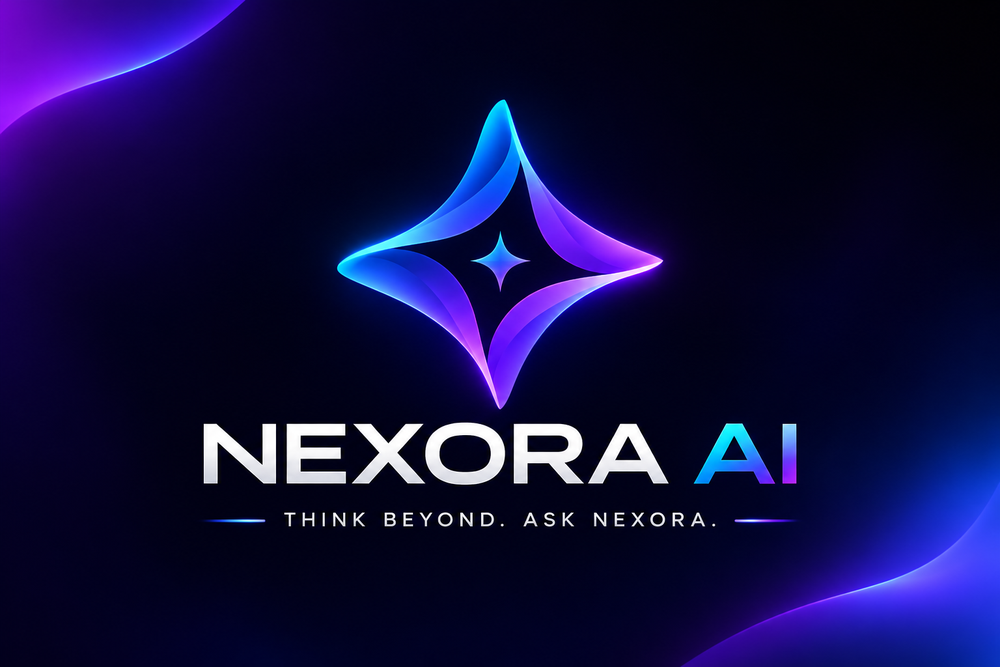
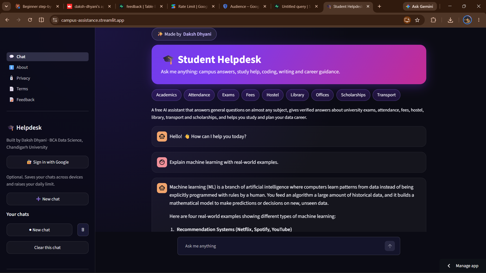

<p align="center">
  
</p>

# Nexora AI

A free AI assistant for everyone: students, working professionals and curious people. Ask about almost any subject and get help with learning, work, coding, writing and everyday problems. It can also search the web for current topics, with source links, and it gives **verified answers** about Chandigarh University as one optional feature.

**Live app:** https://nexora-ai-global.streamlit.app



## Features

- **General AI assistant** (Google Gemini): explanations, coding help, writing, study help, career advice and everyday questions.
- **Live web search with sources:** for questions that sound current (news, prices, versions, comparisons), it searches the web (Tavily) and shows numbered source links under the answer. If search is unavailable, it says so instead of guessing.
- **Clean formatting:** headings, lists, tables and code blocks.
- **Conversation memory:** follow-up questions such as "make it shorter" work within a chat.
- **Personalization:** an optional "About you" panel (name, role, level, answer style, goal) tailors answers. It is kept only for the visit.
- **Verified university answers** from `data/faq.csv`, matched with TF-IDF and cosine similarity (scikit-learn). Chandigarh University answers do not come from the AI's memory or from web search.
- **Career guidance** from `data/career_guide.md`, labelled as general industry advice.
- **Study helper:** upload notes or a syllabus (PDF or text) for study plans, notes and practice questions.
- **Optional Google sign-in** (Streamlit login). Signed-in users get chats saved across devices (Supabase).
- **Multiple chats, Copy and Regenerate.**
- **Usage limits:** per visit, per user per day, and site-wide per day for AI answers and for web searches, to stay within free quotas.
- **Prompt-injection hardening:** user text, chat history, uploads and web results are treated as untrusted data. This reduces the risk, but does not remove it.
- **Pages:** About, Privacy, Terms and a Feedback form (stored in Supabase).

## Tech stack

Python, Streamlit, scikit-learn, Google Gemini API (`google-genai`), Tavily Search API, Supabase (REST), Google OAuth (Streamlit `st.login`).

## Project structure

```
app.py                 page navigation and logo
chat.py                chat page
site_pages/            About, Privacy, Terms, Feedback
src/chatbot.py         verified-answer matching
src/search.py          web search (Tavily)
src/db.py              Supabase access (chats, usage, feedback)
data/faq.csv           verified university facts
data/career_guide.md   general career guidance
assets/                logo and icon
requirements.txt
```

## Run locally

```
pip install -r requirements.txt
streamlit run app.py
```

Create `.streamlit/secrets.toml` (never commit it). Keep the top-level keys above the `[auth]` and `[supabase]` sections:

```toml
GEMINI_API_KEY = "your-gemini-key"
TAVILY_API_KEY = "your-tavily-key"

[auth]
redirect_uri = "http://localhost:8501/oauth2callback"
cookie_secret = "a-long-random-string"
client_id = "your-google-client-id"
client_secret = "your-google-client-secret"
server_metadata_url = "https://accounts.google.com/.well-known/openid-configuration"

[supabase]
url = "your-supabase-url"
key = "your-supabase-secret-key"
```

Without `TAVILY_API_KEY` the app still runs, without live search. Without the `[auth]` and `[supabase]` sections it runs without sign-in and saved chats. Saving chats needs three Supabase tables (`conversations`, `usage_log`, `feedback`) and a `bump_usage` function.

## Limitations

- Not an official service of any university or company. Answers outside the verified university facts come from an AI and can be wrong, so double-check anything important, especially health, money and legal topics.
- Web search runs only for questions that sound current, and has a daily cap. Search results can be wrong or incomplete, so check the source links.
- The free hosting, free Gemini quota and free search quota limit how many people can use it at once. Google's model can also be temporarily overloaded.
- Don't enter personal or confidential information.

## Author

Daksh Dhyani, BCA (Data Science), Chandigarh University. [GitHub](https://github.com/Daksh-Dhyani)